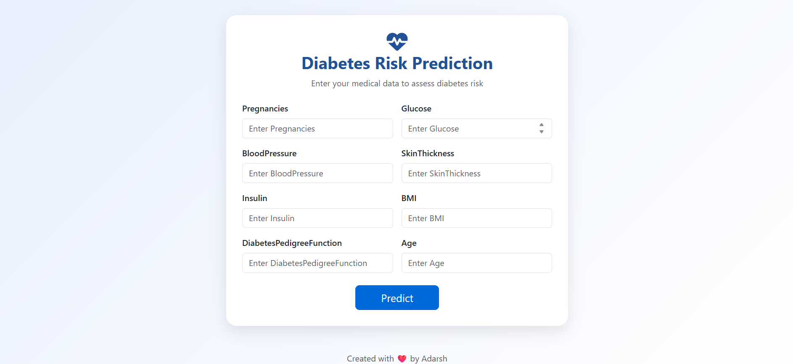

# 🩺 Diabetes Prediction Web App

A modern and responsive web application that predicts whether a person is likely to have diabetes based on medical inputs. Built using **Flask**, **Logistic Regression**, and styled with **Bootstrap 5**.



---

## 🚀 Features

- 🔍 Predicts diabetes using user-provided health metrics
- 🧠 Machine learning model (Logistic Regression)
- 🌐 Modern medical UI with responsive Bootstrap layout
- 💬 Popup-based result display (Diabetes / No Diabetes)
- 📦 Trained model saved with `joblib`
- ⚙️ Scaled input data for accurate predictions
- 🧪 Accuracy ~78% (train) and ~76% (test)
- ❤️ Clean and modular project architecture

---

## 📁 Project Structure

```
diabetes-predictor/
│
├── data/
│   └── diabetes.csv                # Pima Indians Diabetes dataset
│
├── models/
│   ├── model.joblib                # Trained Logistic Regression model
│   └── scaler.joblib               # StandardScaler for input normalization
│
├── notebooks/
│   └── diabetes_prediction.ipynb   # Jupyter notebook for exploration & training
│
├── static/
│   ├── css/
│   │   └── style.css               # Custom styling
│   └── images/
│       └── preview.png             # App preview image
│
├── templates/
│   └── index.html                  # Frontend HTML form
│
├── LICENSE                         # MIT License
├── Procfile                        # Deployment command
├── app.py                          # Flask backend application
├── requirements.txt                # Python dependencies
└── README.md                       # Project documentation
```

---

## 📊 Dataset Info

- Source: [Pima Indians Diabetes Dataset](https://www.kaggle.com/datasets/uciml/pima-indians-diabetes-database)
- Columns:
  - Pregnancies
  - Glucose
  - BloodPressure
  - SkinThickness
  - Insulin
  - BMI
  - DiabetesPedigreeFunction
  - Age
  - Outcome (0 = No Diabetes, 1 = Diabetes)

---

## 🧠 Model Training

```python
from sklearn.linear_model import LogisticRegression
from sklearn.preprocessing import StandardScaler
import joblib

# Scale features
scaler = StandardScaler()
x_train_scaled = scaler.fit_transform(x_train)

# Training the model
regression = LogisticRegression(class_weight='balanced')
regression.fit(x_train_scaled, y_train)

# Save model and scaler
joblib.dump(regression, "models/model.joblib")
joblib.dump(scaler, "models/scaler.joblib")
```

---

## 🖥️ How to Run Locally

### 1️⃣ Clone the Repo
```bash
git clone https://github.com/prashant20singh04/Diabetes-Prediction.git
cd Diabetes-Prediction
```

### 2️⃣ Create a Virtual Environment
```bash
python -m venv .venv
source .venv/bin/activate    # macOS/Linux
.venv\Scripts\activate       # Windows
```

### 3️⃣ Install Dependencies
```bash
pip install -r requirements.txt
```

### 4️⃣ Run the App
```bash
python app.py
```
Then open [http://127.0.0.1:5000](http://127.0.0.1:5000) in your browser.

---

## 🌐 Live Demo

[🔗 Live App on Railway](https://diabetesprediction.up.railway.app/)

---

## 📦 Requirements

```
Flask
scikit-learn
pandas
numpy
joblib
gunicorn
```

Or install manually:
```bash
pip install Flask scikit-learn pandas numpy joblib gunicorn
```

---

## 🖌️ Screenshots


---

## 🙌 Contributing

Pull requests are welcome. If you’d like to add new models or improve the UI, feel free to fork and submit a PR.

---

## 📄 License

This project is open-source under the [MIT License](LICENSE).

---

## 👨‍⚕️ Created with ❤️ by Uday Pratap Singh